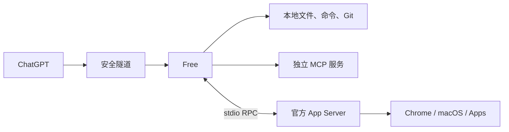

# Codex Free

让 ChatGPT 使用你电脑上的文件、命令、Git 和 MCP 工具。

## 快速开始

安装 Rust 后，在源码目录运行：

```sh
cargo run --release -- quickstart
```

按提示选择项目、配置安全隧道，并在 ChatGPT 中添加连接。运行期间保持服务开启。

配置默认保存在 `~/.codex-free/codex.config.json`。已有安装的启动方式见[使用参考](docs/REFERENCE.md#quick-start)。

## 工作方式



Free 是一个 Rust 服务，负责执行和转发工具调用，模型在聊天侧运行。

- 本地工具：文件读写、搜索、命令执行、Git、文件传输与预览。
- 项目管理：多个项目共用一个服务，每个聊天选择自己的项目。
- 可选扩展：接入独立 MCP；通过官方 App Server 使用 Chrome 和原生 UI。

App Server 适配器在 Rust 内部，按需启动官方 CLI 子进程，处理运行时上下文、图片和确认表单；两者之间通过标准输入输出通信。上游工具名称和参数从运行中的服务读取。具体过程见[架构说明](docs/ARCHITECTURE.md)。

## 代码放在哪里

| 目录 | 用途 |
|---|---|
| `src/` | Rust 主服务、本地工具和 App Server 接入 |
| `integrations/` | 服务适配器与主机配置模板 |
| `scripts/` | 安装、更新与签名 |
| `tests/` | 回归测试 |
| `docs/` | 架构与使用参考 |

## 按需查阅

- [架构概览](docs/ARCHITECTURE.md)
- [完整用法：CLI、配置、工具](docs/REFERENCE.md)
- [Mac 更新与持久签名](docs/REFERENCE.md#local-macos-updates)
- [Mac UI 桥接](integrations/codex-app-server-bridge/README.md)

## 开发

```sh
cargo test
cargo clippy --all-targets
```

基于 [hypnguyen1209/codex-free](https://github.com/hypnguyen1209/codex-free) 的 Rust 版本维护。采用 [MIT](LICENSE) 许可证。
