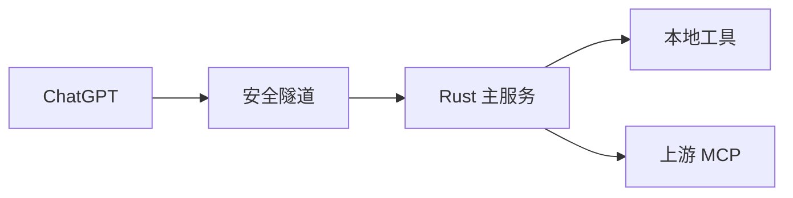

# 架构概览

Free 的核心是一个 Rust 服务：接收 MCP 请求，确定项目，然后执行本地工具或转发给上游 MCP。

## 主链路



模型在聊天侧运行。文件、命令、Git、项目状态、预览和工具目录都是 Free 内部模块，不是独立服务。

使用原生安全隧道时，Free 管理一个官方隧道客户端进程。远程 MCP 通过 HTTP 连接；本地 stdio MCP 通常各有子进程。

## 代码分工

| 部分 | 位置 | 作用 |
|---|---|---|
| 服务入口 | `main.rs`、`server.rs` | 启动服务、接收请求、返回结果 |
| 本地工具 | `registry.rs`、`tools/` | 文件、命令、Git、预览等 |
| 项目与状态 | `project_*.rs`、`exec_sessions.rs`、`review*.rs` | 项目选择、命令会话和变更检查 |
| MCP 接入 | `bridge.rs`、`mcp_catalog.rs`、`codex_mcp.rs` | 导入、查找并调用上游工具 |
| 配置与授权 | `config.rs`、`auth.rs`、`shared_oauth.rs` | 配置、入口认证、读取共享访问令牌 |
| 可选适配器 | `integrations/` | Mac UI、服务专用接入 |

前五行位于 `src/`。`scripts/` 负责安装、签名和更新，不参与日常工具调用。

## 一次请求做什么

1. 根据聊天身份找到项目；多项目模式下，首次使用需要选择项目。
2. 校验该调用需要的项目、执行策略和授权。
3. 调用 Rust 本地工具，或交给已连接的上游 MCP。
4. 返回文本、图片或文件资源。

项目绑定可以持久保存，运行中的命令保存在内存。两者都不需要保存聊天全文。

## Mac UI 为什么多一层

```text
Free → Node 桥接 → 官方 Codex App Server → Chrome / macOS 控制
```

这条可选链路复用现有的电脑控制能力。桥接还负责图片返回和需要真人回答的确认表单，不启动模型回合。

普通文件、命令和 Git 操作由 Rust 直接完成，不经过这条链路。Free 自己的 HTML 预览也不是浏览器控制。

## 还能精简什么

当前确实存在重复入口：Rust 已提供文件、命令、Skills 和 MCP 调用，Node 桥接又暴露了一部分同类能力。

后续代码精简应集中在三件事：

- 文件、命令和项目管理统一由 Rust 负责。
- 通用上游 MCP 调用统一走 Free 的工具目录。
- Node 桥接收敛到仍需官方运行时的能力，例如 Mac UI、Apps 和确认处理。

有些上游目前仍依赖原生桥接作为兼容路径，须在替代路径实测通过后再删除。上述是精简方向，当前文档调整没有改变运行链路。

CLI、配置和工具参数见[使用参考](REFERENCE.md)。
