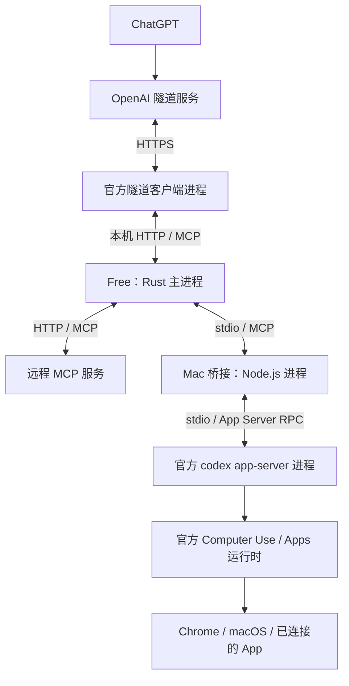

# 架构与调用过程

Free 是一个 Rust MCP 服务，负责本地工具和上游工具的统一入口。模型在聊天侧运行；Mac 控制、第三方 API 和安装更新各有自己的适配部分。

## 1. 哪些组件实际在运行

下图区分主进程、子进程和远端服务，不把 Rust 内部的每个工具都画成服务。



| 组件 | 负责什么 | 何时需要 |
|---|---|---|
| Free / Rust | 接收请求，管理项目，执行文件、命令、Git、预览，调度上游 MCP | 核心服务 |
| 官方隧道客户端 | 向 OpenAI 发起出站连接，将请求转到 Free 的本机端口 | 使用原生安全隧道时 |
| Node.js 桥接 | 把 MCP 工具调用转换为官方 App Server RPC，处理结果和确认流程 | 使用官方运行时能力时 |
| 官方 `codex app-server` | 提供运行时、MCP、Apps 等接口，并管理其工具执行上下文 | 由 Node 桥接按需启动 |
| 服务专用适配器 | 将某个服务的 API 包装为 MCP，例如富途只读适配器 | 启用对应服务时 |

Free 使用 **Tokio** 处理异步任务、**Axum** 提供 `/mcp` 和 `/health`、**rmcp** 实现 MCP 协议。文件、命令、Git 等工具是同一 Rust 进程里的模块；执行命令时才启动相应子进程。

## 2. Node 到底做什么

**Node.js 是 JavaScript 运行环境。这里常驻的 Node 程序是协议适配器，实际电脑控制由官方运行时执行。**

实现位于 [`integrations/codex-app-server-bridge/`](../integrations/codex-app-server-bridge/README.md)：

| 职责 | 具体机制 |
|---|---|
| 对接 Free | 从 stdin 读取按行 JSON 的 MCP 请求，通过 stdout 返回结果 |
| 对接官方 CLI | 按需启动 `codex app-server --listen stdio://`，通过请求 ID 匹配 RPC 响应 |
| 调用电脑控制 | 将 `codex_cua_js` 转成 `mcpServer/tool/call`，调用官方 `cua_repl` 或可用的 `node_repl` |
| 保留执行上下文 | 创建并复用临时工具上下文，使连续浏览器操作能保留变量和句柄；不调用模型的 `turn/start` |
| 返回截图 | 保留 MCP 原生图片块、`structuredContent`、`_meta` 和错误状态，避免把图片编码成普通文字 |
| 处理真人确认 | 暂停原操作，返回确认表单；收到真实用户回答后继续同一个操作 |

确认操作在桥接内串行执行，因为上游确认请求不总能标明原始调用。Free 提供的调用者哈希用于隔离不同聊天的待确认操作。桥接重启后这些内存状态会消失，因此不能自动重放未确认结果的写入。

桥接的临时工具上下文不包含 ChatGPT 聊天全文。它有独立配置的工作目录，**不会自动继承 Free 当前聊天选中的项目**。

它连接的是自己启动的 CLI 子进程，而不是把操作发送到桌面中已有的某个聊天。

Node 是当前适配器的实现选择；Rust 也能实现同样的协议。要合并它，需要一起迁移进程管理、运行时上下文、图片返回和确认语义。

## 3. 三种请求分别走哪里

### 读取文件、运行命令

```text
ChatGPT → 隧道 → Free → Rust 工具 → 文件系统 / 命令子进程
```

`registry.rs` 注册工具，`server.rs` 根据聊天身份找到项目并调度。`exec_command` 的运行进程由 Rust 管理，`write_stdin` 继续同一个命令会话。这个过程不经过 Node 桥接。

### 操作 Chrome 并返回截图

```text
ChatGPT → 隧道 → Free → Node 桥接 → App Server → Computer Use → Chrome
```

Free 将调用发给桥接这个 stdio MCP 上游；桥接调用官方运行时的 JavaScript 工具，再由运行时操作 Chrome 或原生界面。截图沿原链路以 MCP 图片块返回。浏览器后端取决于官方运行时实际暴露的能力，不能据此假定独立桥接拥有桌面内置浏览器。

### 调用远程 MCP 或富途 API

普通远程 MCP 走 `Free → HTTP → 远程 MCP`，通常不需要 Node 桥接。某些依赖官方运行时的服务仍可经 App Server 转发。

富途使用单独的只读适配器：

```text
Free → stdio MCP → Python 适配器 → HTTPS GET → 富途 API
                         └→ 短时 Node 签名助手
```

Python 负责 MCP 协议和 HTTP 请求，每次请求临时调用 `sign.mjs`，使用 Node 内置 crypto 完成 Ed25519 或 RSA 签名。这与前面的常驻 Node 桥接是两个用途，也与 macOS 程序签名不同。

## 4. 配置、会话和授权由谁管理

| 对象 | 管理者与位置 | 重启后的行为 |
|---|---|---|
| Free 配置 | `~/.codex-free/codex.config.json` | 启动时读取，修改配置需重新加载服务 |
| 上游 MCP 定义 | 导入 Codex 配置，再应用 Free 的覆盖项 | 重新连接；默认通过统一工具目录查找和调用 |
| 项目绑定 | Rust 按聊天标识哈希保存到本机；普通 MCP 客户端用传输会话回退 | 稳定聊天身份可恢复，普通传输会话需重新选择 |
| 运行中的命令 | Rust 内存中的进程句柄与输出缓冲 | Free 重启后不保留 |
| UI 变量和待确认操作 | 官方运行时和 Node 桥接的内存 | 桥接重启后不能依赖原状态继续 |
| 共享 OAuth | 官方 Codex 保存、刷新；Free 按请求加锁读取访问令牌 | 读取最新令牌，不另建刷新逻辑 |

共享 OAuth 读取会核对服务名、URL、凭据文件权限、有效期和允许范围；Free 不操作刷新令牌。服务没有有效凭据时返回诊断，不能自动开启一轮新授权。

原生隧道模式另有一个随机的本机入口 bearer。它保护隧道客户端到 Free 的连接，和上游 OAuth、macOS 辅助功能或录屏许可分别管理。

安装签名由 `scripts/` 在更新时完成：备份 → 签名 → 严格验证及旧身份兼容检查 → 原子替换 → 重启和健康检查。它不参与每次工具调用。

持久签名用于维持程序身份；macOS 隐私许可仍按实际调用责任链判定，不能用 Node 进程名或官方 Codex 的许可代替 Free 的权限验收。

## 5. 源码从哪里读，哪些还能合并

| 要了解的部分 | 入口 |
|---|---|
| 启动与请求调度 | `src/main.rs`、`src/server.rs` |
| 本地工具 | `src/registry.rs`、`src/tools/` |
| 项目和命令会话 | `src/project_bindings.rs`、`src/exec_sessions.rs` |
| MCP 连接、目录和 OAuth | `src/bridge.rs`、`src/mcp_catalog.rs`、`src/shared_oauth.rs` |
| Mac 桥接 | `integrations/codex-app-server-bridge/server.mjs`、`confirmations.mjs`、`mcp-result.mjs` |
| 富途适配 | `integrations/futu-readonly/server.py`、`sign.mjs` |

当前重复主要是：Node 桥接又提供了一部分文件、命令、Skills 和通用 MCP 入口，而 Rust 已具备相近能力。但两条路径的执行策略、工作目录和上下文不完全相同，需要逐项迁移和验收后才能删除。

合理的精简方向是 **Rust 统一常规工具和项目管理，适配器保留确有必要的运行时或服务接入**。本页描述当前实现，尚未合并上述重复入口。

CLI、配置和完整工具参数见[使用参考](REFERENCE.md)。
