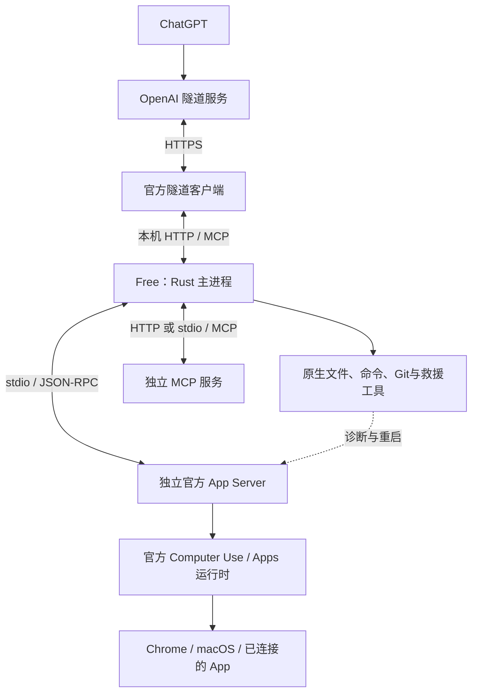

# 架构与调用过程

Free 是一个 Rust MCP 服务：接收聊天侧的工具请求，执行本地操作，或把请求发给相应服务。模型在聊天侧运行。

## 1. 实际运行的组件

| 组件 | 职责 |
|---|---|
| Free / Rust | HTTP 入口、项目绑定、工具目录、本地执行与 App Server 协议适配 |
| 官方隧道客户端 | 建立出站安全连接，将请求送到本机 Free |
| 官方 App Server | 提供 Computer Use、Apps、兼容 MCP 等运行时接口；由 Free 按需启动 |
| 独立 MCP 服务 | 提供某项专门能力，例如 Cloudflare、米家或券商只读查询 |

Free 内部使用 **Tokio** 调度异步任务、**Axum** 提供 `/mcp` 和 `/health`、**rmcp** 处理 MCP。文件、命令和 Git 是 Rust 模块；执行命令时才启动对应子进程。

App Server 是单独的官方 CLI 进程，与桌面 App 中的已有实例分开。Free 自己实现协议适配，不再启动自有的常驻 Node 转接程序。官方工具运行时或某个独立服务仍可能使用 Node。

## 2. 三条调用路径

**本地文件、命令与 Git**：`聊天 → 隧道 → Free → Rust 工具`。`exec_command` 管理命令进程，`write_stdin` 继续同一会话；它们不依赖 App Server，可用于故障诊断和恢复。

**Chrome 与原生 UI**：`聊天 → 隧道 → Free → 官方 App Server → Computer Use`。`src/app_server/` 通过管道发送每行一个 JSON 的 RPC，以请求 ID 匹配结果，不开放额外监听端口。

Free 按需建立并复用一个临时工具上下文，使连续操作能保留变量和浏览器句柄。它不启动模型的 `turn/start`，也不传入 ChatGPT 聊天全文。这个上下文采用单独配置的工作目录，不自动继承聊天当前选中的项目。浏览器后端取决于官方运行时实际提供的能力。

截图和其他媒体沿原链路以 MCP 内容块返回，保留结构化结果、元数据和错误状态。

**独立 MCP**：`聊天 → 隧道 → Free → MCP 服务`。本地服务通过 stdio 通信，远程服务使用 HTTP；需要官方运行时兼容性的工具也可通过 App Server 调用。

例如，富途只读适配器使用 `Free → Python MCP → HTTPS GET → 富途 API`，每次请求短时调用 Node 的 crypto 完成 API 签名。它与 Free 的 macOS 程序签名是两回事。

## 3. 工具如何随上游更新

Free 保留 26 个兼容入口，例如状态、通用 MCP 调用、Computer Use 和确认回应。它们负责接入协议。

具体 MCP 工具从 App Server 的实时目录发现：

1. `codex_mcp_status` 查当前服务与工具名。
2. 带 `serverName` 和 `toolName` 再查一次，取得该工具的完整说明与参数结构。
3. `codex_mcp_call` 按查到的名称和参数执行。

因此，上游新增或修改业务工具不需要在 Free 中逐个登记。底层 App Server RPC 协议若发生不兼容变化，仍需更新适配器；工具发现不能自动修复协议变更。

## 4. 确认、授权与恢复

需要用户确认时，Free 暂停原操作并返回实际表单。收到明确回答后继续同一个 RPC，不重新发起原调用。各聊天的待确认操作按服务端生成的身份哈希隔离；设备验证不能用文字同意替代。

上游确认请求不总能标明原始工具调用，所以 App Server 操作在适配器内串行执行。原生 Rust 救援工具独立运行。确认与 UI 上下文保存在内存中；重启后应先核对外部结果，再决定是否重试写入。

App Server 退出时，当前操作报错，下一次新调用按需建立新进程。Free 只管理自己启动的进程，不重启桌面 App 的实例，也不自动重放失败的写入或 OAuth 登录。卡住时可通过原生 `exec_command`、`write_stdin`、文件工具或 `local_shell/exec` 诊断并修复。

| 状态 | 管理者 |
|---|---|
| Free 配置 | `~/.codex-free/codex.config.json`；启动时读取 |
| App Server 主机路径与超时 | `appServer` 配置，可引用不入 Git 的个人 JSON 文件 |
| 项目绑定 | Rust 按聊天身份保存；普通 MCP 客户端按传输会话回退 |
| UI 变量、命令会话、待确认操作 | 所属进程的内存；重启后不保证延续 |
| 共享 OAuth | 官方 Codex 保存和刷新；Free 按请求加锁读取有效访问令牌 |
| macOS 隐私权限 | 系统按实际调用责任链判定，需通过真实 Free 路径验收 |

安装更新仍走持久签名、旧身份兼容检查、原子替换、服务重载与失败回滚。LaunchAgent 保留异常退出恢复。稳定签名能维持程序身份，首次使用新能力或系统策略变化仍可能要求用户确认权限。

## 5. 源码入口

| 内容 | 位置 |
|---|---|
| 启动、请求调度 | `src/main.rs`、`src/server.rs` |
| 本地工具与命令会话 | `src/registry.rs`、`src/tools/`、`src/exec_sessions.rs` |
| MCP 连接、目录与 OAuth | `src/bridge.rs`、`src/mcp_catalog.rs`、`src/shared_oauth.rs` |
| App Server 进程、RPC、确认与媒体 | `src/app_server/` |
| App Server 配置模板 | `integrations/codex-app-server-bridge/` |
| 富途只读适配 | `integrations/futu-readonly/` |
| 安装、签名与回滚 | `scripts/` |

配置及工具参数见[使用参考](REFERENCE.md)，主机接入示例见 [App Server 配置](../integrations/codex-app-server-bridge/README.md)。
